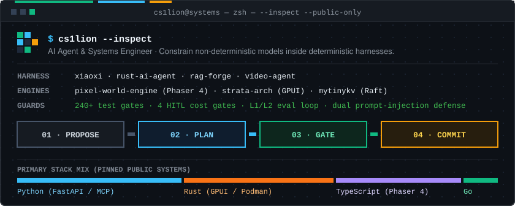

  <picture>
    <source media="(prefers-color-scheme: dark)" srcset="./assets/hero-dark.svg">
    <source media="(prefers-color-scheme: light)" srcset="./assets/hero-light.svg">
    
  </picture>

### Featured Systems

<table>
  <tr>
    <td width="50%" valign="top">
      <strong><a href="/cs1lion/xiaoxi">xiaoxi</a></strong> &nbsp;<code>Python</code> <code>FastAPI</code> <code>MCP</code>  
      Non-blocking System 1/2 personal voice agent — async multi-agent offload, 3-tier confidence memory, 3x loop circuit-breakers &amp; L1/L2 deterministic eval.
    </td>
    <td width="50%" valign="top">
      <strong><a href="/cs1lion/rust-ai-agent">rust-ai-agent</a></strong> &nbsp;<code>Rust</code> <code>Podman</code> <code>MCP</code>  
      High-performance Rust ReAct runtime — <code>before_llm</code> / <code>after_tool</code> context compression, Podman container sandbox &amp; GAIA eval harness.
    </td>
  </tr>
  <tr>
    <td width="50%" valign="top">
      <strong><a href="/cs1lion/pixel-world-engine">pixel-world-engine</a></strong> &nbsp;<code>TypeScript</code> <code>Phaser 4</code> <code>FastAPI</code>  
      Runs 100% offline without an LLM — fixed-timestep Phaser 4 world engine where models only propose schema-whitelisted commands (240+ test gates).
    </td>
    <td width="50%" valign="top">
      <strong><a href="/cs1lion/rag-forge">rag-forge</a></strong> &nbsp;<code>Python</code> <code>React</code> <code>Remotion</code>  
      Citation-enforced RAG &amp; automated Q&amp;A video workbench — local BM25/TF-IDF hybrid retrieval, dual prompt-injection defense &amp; crash-recoverable FIFO video queue.
    </td>
  </tr>
  <tr>
    <td width="50%" valign="top">
      <strong><a href="/cs1lion/video-agent">video-agent</a></strong> &nbsp;<code>TypeScript</code> <code>Node.js</code> <code>FFmpeg</code>  
      Dialogue-driven 7-stage Director Agent video pipeline — 4 HITL cost gates to cap GPU/API burn, deterministic FFmpeg synthesis &amp; QA auto-repair loop.
    </td>
    <td width="50%" valign="top">
      <strong><a href="/cs1lion/strata-arch">strata-arch</a></strong> &nbsp;<code>Rust</code> <code>GPUI</code> <code>AST</code>  
      Local-first TS/JS static architecture analyzer in Rust + GPUI — layered dependency map, commit timeline, structural diff &amp; call-path replay.
    </td>
  </tr>
  <tr>
    <td width="50%" valign="top">
      <strong><a href="/cs1lion/AdCraft">AdCraft</a></strong> <em>(Fork)</em> &nbsp;<code>Python</code> <code>Three.js</code> <code>TS</code>  
      3D pre-visualization director workbench fork featuring verifiable SceneScript contracts, headless Three.js rendering &amp; multi-track timeline.
    </td>
    <td width="50%" valign="top">
      <strong><a href="/cs1lion/mytinykv">mytinykv</a></strong> &nbsp;<code>Go</code> <code>Raft</code> <code>MVCC</code>  
      Distributed Key-Value storage engine implementing Raft consensus, Multi-Raft region split &amp; Percolator-style MVCC transactions.
    </td>
  </tr>
</table>

<strong>Architecture &amp; Engineering Invariants (Click to expand)</strong>

 

- **Control Plane**: System 1/2 fast-slow dual-loop routing (`xiaoxi`), schema-whitelisted commands (`pixel-world-engine`), Pi / MCP / dynamic `SKILL.md` ecosystems, and 4 HITL cost gates (`video-agent`).
- **Reliability Plane**: 3x loop-signature circuit breakers, L1/L2 deterministic eval loop, dual prompt-injection defense (XML isolation + System Prompt rules in `rag-forge`), and 240+ automated test gates.
- **Runtime Plane**: Offline-capable fixed-timestep simulation (`Phaser 4` + `FastAPI`), local-first AST + `GPUI` desktop analyzer (`strata-arch`), Podman container sandboxes (`rust-ai-agent`), and Raft + Percolator MVCC (`mytinykv`).

### Tech Stack

- **Languages**: `Python` · `Rust` · `TypeScript` · `Go` · `C# (.NET)`
- **Engines & Infra**: `FastAPI` · `React` · `Phaser 4` · `Remotion` · `GPUI` · `SQLite` · `PostgreSQL` · `Podman` · `Docker` · `FFmpeg`
